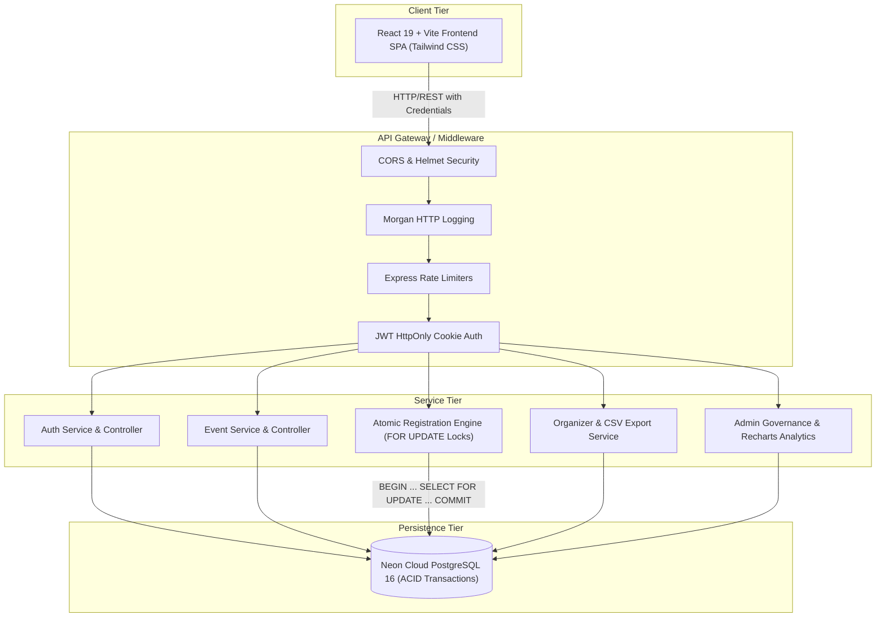

# eLabs Student Registration and Event Management System

A production-ready, full-stack campus event registration platform built for high-concurrency event bookings, dynamic seat tracking, and role-based administration.

---

## Architecture Diagram



---

## Tech Stack

- **Backend:** Node.js, Express 4.x, PostgreSQL (`pg` raw queries, no ORM), JWT in `HttpOnly` SameSite cookies, bcrypt (cost 12), Zod validation, Pino + Morgan logging, Helmet security headers.
- **Frontend:** React 19, Vite, Tailwind CSS (Indigo/Violet palette), Inter typography, Recharts analytics, Lucide icons, Context API (`AuthContext`, `ThemeContext`, `ToastContext`).
- **Database:** PostgreSQL 16 on Neon Cloud with ACID transactions and row-level locking (`SELECT ... FOR UPDATE`).

---

## Seed Credentials

| Role | Email | Password |
| :--- | :--- | :--- |
| **System Admin** | `admin@elabs.kiit.ac.in` | `Admin123!` |
| **Event Organizer** | `organizer@elabs.kiit.ac.in` | `Organizer123!` |
| **Student** | `student@elabs.kiit.ac.in` | `Student123!` |

---

## Quickstart & Local Setup

### 1. Prerequisites
- Node.js >= 20.x
- PostgreSQL >= 16 (or Neon Cloud URL)
- Docker & Docker Compose (optional)

### 2. Backend Setup
```bash
cd backend
npm install

# Configure .env file
cp .env.example .env

# Run database schema migration and seed data
npm run db:migrate
npm run db:seed

# Start dev server
npm run dev
```
Backend runs on `http://localhost:5000`.

### 3. Frontend Setup
```bash
cd frontend
npm install
npm run dev
```
Frontend runs on `http://localhost:5173`.

### 4. Running with Docker Compose
```bash
docker compose up -d
```
Starts PostgreSQL on port `5432` and the Node.js backend on port `5000`.

---

## NPM Scripts Summary

### Backend (`/backend`)
- `npm start` - Starts production server.
- `npm run dev` - Starts development server with hot-reload via nodemon.
- `npm test` - Runs Jest test suites (auth, events, concurrency, admin).
- `npm run db:migrate` - Applies database schema.
- `npm run db:seed` - Seeds default users and mock campus events.

### Frontend (`/frontend`)
- `npm run dev` - Launches Vite development server.
- `npm run build` - Generates optimized production build in `/dist`.
- `npm run preview` - Previews production build locally.

---

## Documentation Links
- [API Specification & Endpoints](docs/API.md)
- [Render Deployment Guide](docs/DEPLOYMENT.md)
